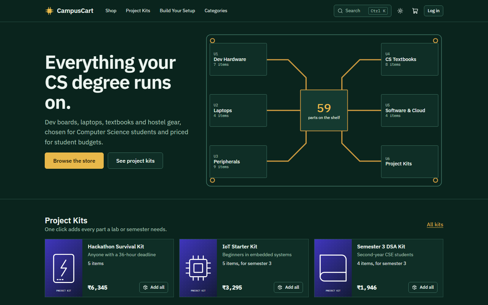
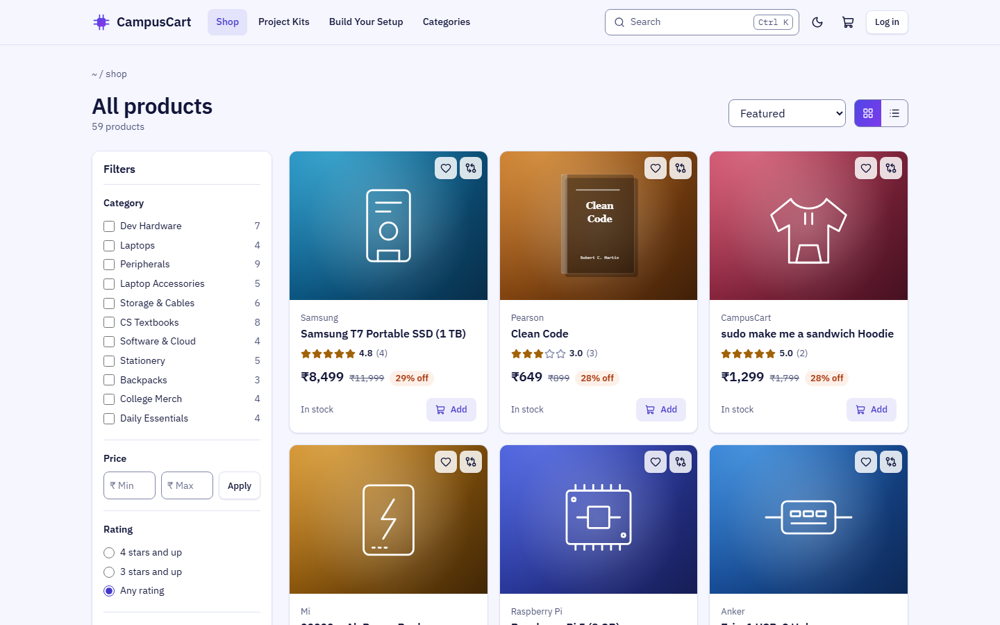
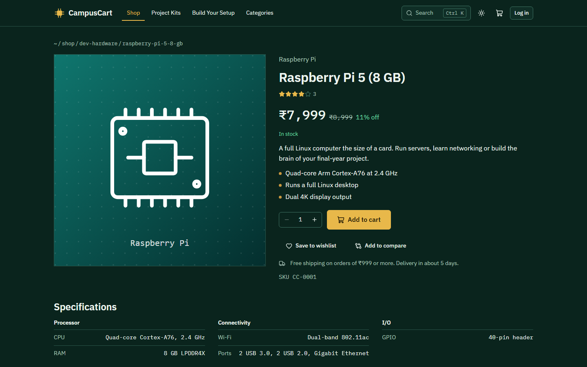
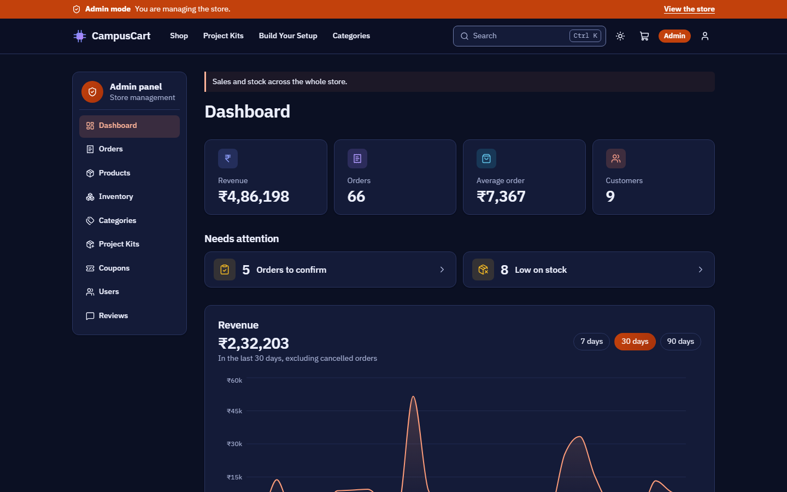
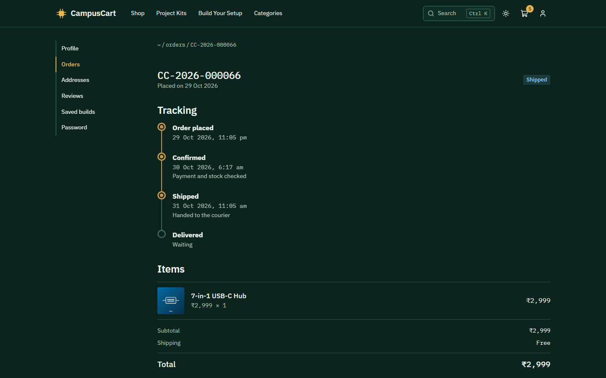

# CampusCart

**Gear up for your CS degree.** CampusCart is a full-stack e-commerce platform for Computer Science students, built with React, Node.js, Express and MongoDB.



## Run it

You need [Node.js](https://nodejs.org) 20.19 or newer. MongoDB doesn't need to be installed.

```bash
npm install
npm start
```

Then open <http://localhost:5000>. The database and demo data are set up automatically.

The first start downloads the database engine (about 70 MB), so it needs internet. After that, CampusCart runs offline.

### Demo accounts

The login page has one-click buttons for these.

| Role | Email | Password |
|---|---|---|
| Student | `student@campuscart.dev` | `Student@123` |
| Admin | `admin@campuscart.dev` | `Admin@123` |

### Commands

| Command | What it does |
|---|---|
| `npm start` | Builds the app if needed, then runs it at port 5000. **Use this for the demo** |
| `npm run dev` | Development mode with live reload, at <http://localhost:5173> |
| `npm run db:reset` | Restores the demo data |
| `npm test` | Runs the API tests |
| `npm run test:e2e` | Runs the browser and accessibility tests |

## Features

**For students**

- Accounts with a profile, password change and saved addresses
- Search, with partial-word matching and `Ctrl+K` quick search
- Filters for category, brand, price, rating, stock and semester, with sorting and pagination
- Product pages with grouped specifications and verified-purchase reviews
- Cart with live stock checks and coupons
- Three-step checkout, with Cash on Delivery and simulated UPI and card payments
- Order tracking on a timeline, and cancellation before shipping
- Wishlist
- Dark and light themes

**Built for CS students**

- **Project Kits:** bundles such as the IoT Starter Kit and Semester 5 CSE Kit, added to the cart in one click
- **Build Your Setup:** pick a laptop, keyboard, monitor and more, against a budget, and save the build
- **Compare:** up to 4 products side by side, with differences highlighted
- **Semester filter:** browse what's relevant to your semester
- A catalog of dev boards, CS textbooks and cloud credits, alongside stationery, bags and merch

**For admins**

- Dashboard with revenue, category sales, order status, top products and low-stock alerts
- Full management of products (with image upload), categories, kits and coupons
- Inventory editing, and order processing through `Pending → Confirmed → Shipped → Delivered`
- User management and review moderation

## Screenshots

| Catalog | Product |
|---|---|
|  |  |

| Admin dashboard | Order tracking |
|---|---|
|  |  |

## Tech stack

| Layer | Technology |
|---|---|
| Frontend | React 19, Vite, React Router, TanStack Query, Axios, Recharts, custom CSS |
| Backend | Node.js, Express 5, Zod validation, Multer uploads |
| Database | MongoDB, Mongoose, `mongodb-memory-server` |
| Auth | JWT, bcrypt |
| Testing | Vitest, Supertest, Playwright, axe-core, Newman |

## Project structure

```
client/          React app
  src/api/         API calls
  src/components/  Shared UI
  src/context/     Login, theme and compare state
  src/pages/       Store, shop, account and admin pages
  src/styles/      Design tokens and CSS
server/          Express API
  src/routes/      URL definitions
  src/controllers/ Request handling
  src/services/    Business rules: pricing, orders, coupons
  src/models/      Mongoose schemas
  src/validators/  Input rules
  seed/            Demo data
  tests/           API tests
e2e/             Browser tests
docs/            API reference, ER diagram, Postman, report, slides
```

## The database

CampusCart picks a database when it starts, in this order:

1. `MONGODB_URI`, if set in a `.env` file (see [.env.example](.env.example)).
2. A local MongoDB on port 27017, if one is running.
3. An embedded MongoDB on port 27018, with data saved in `%LOCALAPPDATA%\CampusCart\db`.

An empty database fills itself with demo data. While the app runs, you can browse the embedded database with the MongoDB extension for VS Code or Cursor at `mongodb://127.0.0.1:27018`.

## Documents

- [API reference](docs/API.md)
- [ER diagram and data model](docs/ER-diagram.md)
- [Postman collection](docs/postman/)
- [Project report](docs/CampusCart-Report.docx)
- [Presentation](docs/CampusCart-Presentation.pptx)
- [Review demo script](docs/DEMO-SCRIPT.md)

## Scope

This is an academic project. Payments are simulated and never ask for real details, and product data and prices are illustrative. Production hardening such as rate limiting and email verification is out of scope.

## Troubleshooting

| Problem | Fix |
|---|---|
| Port 5000 is in use | Close the other program, or set `PORT=5001` in a `.env` file |
| `npm install` fails with file-lock errors | The folder is in OneDrive. Pause OneDrive sync and try again |
| Demo data looks messy | Stop the app, then run `npm run db:reset` |
