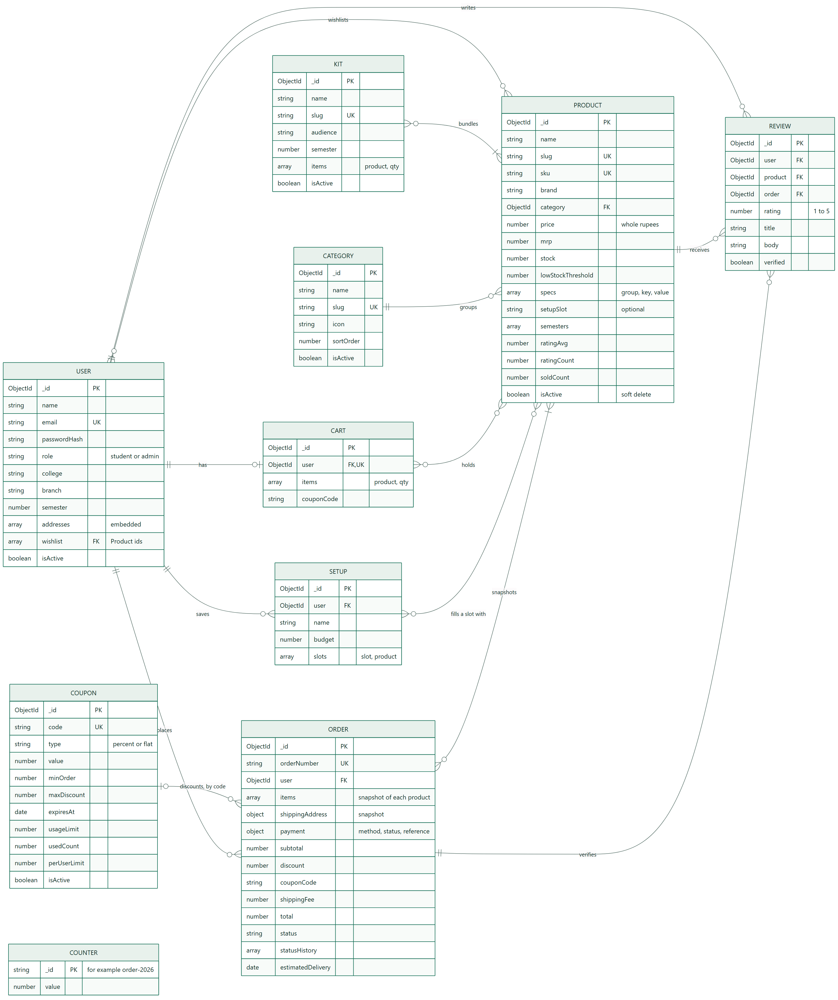
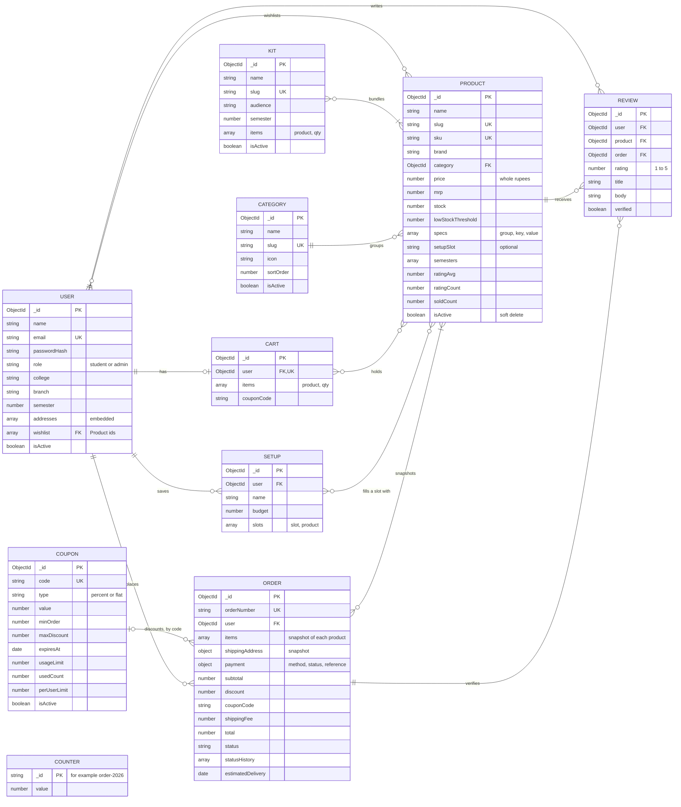

# CampusCart data model

CampusCart stores its data in MongoDB through Mongoose. There are 10 collections. MongoDB doesn't enforce foreign keys, so the relationships below are held as ObjectId references, with the rules enforced in the application.

## Diagram source

## Design decisions

| Decision | Reason |
|---|---|
| Order items and the address are copied onto the order | Later edits to a product or address can't change what an old order shows |
| Cart items store only a product and quantity | Prices are always calculated from the current product, so a cart can't show a stale price |
| Products are hidden, not deleted | Past orders and reviews keep working |
| Money is stored as whole rupees | Avoids decimal rounding errors |
| One review per user and product (a unique index) | The database itself blocks duplicates, even if two requests arrive together |
| `ratingAvg`, `ratingCount` and `soldCount` are stored on the product | Listing and sorting stay fast. They are recalculated whenever a review or order changes |
| `COUNTER` holds the running order number | Incremented atomically, so two orders can't get the same number |
